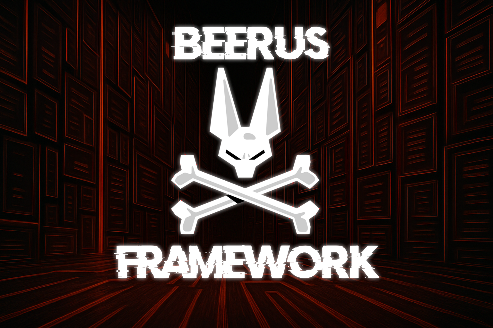

<h1 align="center">Beerus Framework Server</h1>

<p align="center">
  <a href="#" rel="noopener">
    
  </a>
</p>

<div align="center">

[]()
[](https://raw.githubusercontent.com/topjohnwu/magisk-files/count/count.json)
[](https://github.com/hakaioffsec/beerus-server/issues)
[](https://github.com/hakaioffsec/beerus-server/pulls)
[](/LICENSE)

</div>

<p align="center">
Beerus Framework is a project developed by the <strong>Hakai Offensive Security Research Team</strong> to assist you throughout the mobile penetration testing process.<br>
The Beerus Framework server supports the implemented tools by receiving the information sent by the Framework. It is used in the memory dump and sandbox exfiltration functionalities, facilitating the collection of sensitive information directly from the device and its transmission to the analyst's computer.
</p>

## 🪚 Compatibility with tools <a name="compatibility-with-tools"></a>

- **Sandbox & APK Exfiltration** – Extract sensitive data and app binaries from protected directories.
- **Memory Dumping** – Capture in-memory secrets and runtime objects.


## 🛠️ Installation & Use
Before starting the server, you need to download its dependencies. To do this, simply run the following commands:

```bash
git clone https://github.com/hakaioffsec/beerus-server.git
cd beerus-server
pip install -r requirements.txt
```

After that, just start the server with the command below:

```bash
python3 server.py
```

## ✍️ Authors <a name="authors"></a>

- [@lur1el](https://github.com/lur1el)
- [@d3vchac](https://github.com/d3vchac)
- [@Tricta](https://github.com/Tricta)
- [@kelvinmontini](https://github.com/kelvinmontini)
- [@ddaniboy](https://github.com/ddaniboy)